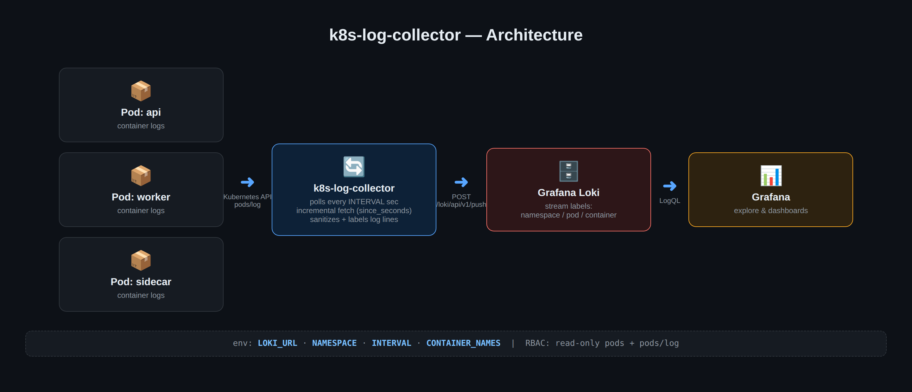
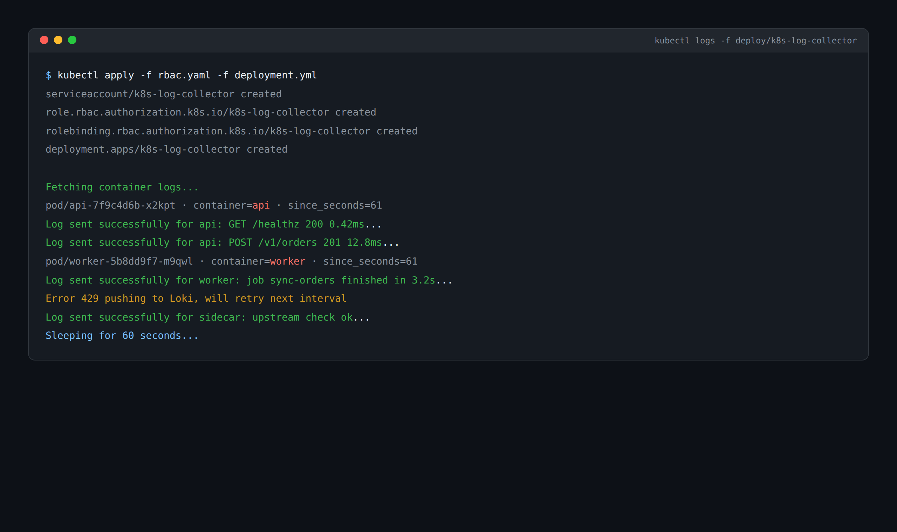
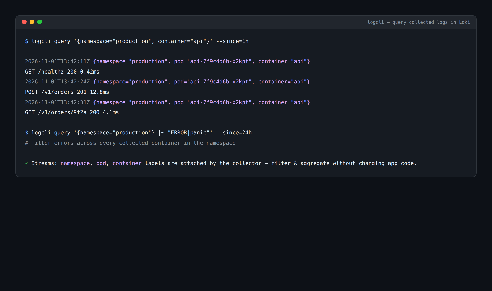
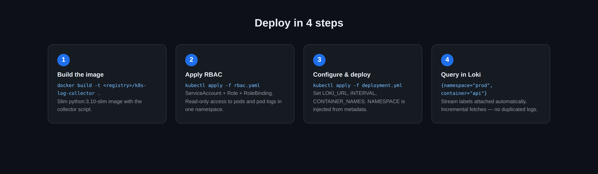

# Kubernetes Log Collector for Loki

<p align="center">
  <a href="https://github.com/davidab265/k8s-log-collecter/actions/workflows/ci.yml"></a>
  <a href="./LICENSE"></a>
  <a href="https://www.python.org/"></a>
  <a href="./SECURITY.md"></a>
</p>

A lightweight service that fetches logs from specific containers in a Kubernetes namespace and forwards them to a Grafana Loki instance. Designed to run as a pod inside the cluster.

## Screenshots

<p align="center">
  
</p>

<p align="center">
  
  
</p>

<p align="center">
  
</p>

## Features

- Fetch logs from specific containers in Kubernetes pods
- Forward logs to a Loki instance with `namespace`, `pod`, and `container` stream labels
- Incremental fetching — only new logs are forwarded each interval
- Clean and sanitize log lines before forwarding
- Environment variable-based configuration

## Requirements

- Python 3.10+
- `kubernetes` Python client
- `requests` library

## Installation

1. Clone the repository:
   ```bash
   git clone https://github.com/davidab265/k8s-log-collecter.git
   cd k8s-log-collecter
   ```

2. Install dependencies:
   ```bash
   pip install -r requirements.txt
   ```

## Configuration

Set the following environment variables:

| Variable | Description | Example |
|---|---|---|
| `LOKI_URL` | Loki push endpoint | `http://loki:3100/loki/api/v1/push` |
| `NAMESPACE` | Kubernetes namespace to monitor | `default` |
| `INTERVAL` | Seconds between log fetches | `30` |
| `CONTAINER_NAMES` | Comma-separated container names to collect | `api,worker` |

Example:

```bash
export LOKI_URL="http://loki:3100/loki/api/v1/push"
export NAMESPACE="default"
export INTERVAL="30"
export CONTAINER_NAMES="app-container,sidecar-container"
```

## Usage

Run the script locally (uses your local kubeconfig when not running in-cluster):

```bash
python k8s_to_loki.py
```

## Deployment in Kubernetes

1. Build and push the Docker image:

   ```bash
   docker build -t <your-registry>/k8s-log-collector:latest .
   docker push <your-registry>/k8s-log-collector:latest
   ```

2. Apply the RBAC manifest (ServiceAccount + Role + RoleBinding granting read-only access to pods and pod logs):

   ```bash
   kubectl apply -f rbac.yaml
   ```

3. Edit `deployment.yml` — set the image reference, `LOKI_URL`, and `CONTAINER_NAMES` — then apply:

   ```bash
   kubectl apply -f deployment.yml
   ```

## Code Structure

- `get_k8s_client()` — Initializes the Kubernetes API client (in-cluster config, falling back to local kubeconfig).
- `parse_timestamp()` — Parses and normalizes Kubernetes timestamp strings.
- `calculate_seconds_since()` — Calculates seconds elapsed since a given timestamp for incremental fetches.
- `get_pod_logs()` — Fetches logs for a specific container in a pod.
- `send_logs_to_loki()` — Pushes sanitized log lines to the configured Loki endpoint.
- `main()` — Continuously fetches logs every `INTERVAL` seconds and forwards them to Loki.

## Troubleshooting

- **`ValueError: <VAR> environment variable is not set`** — Ensure all required environment variables are set before running.
- **Logs not reaching Loki** — Verify `LOKI_URL` is reachable from the pod and points at the `/loki/api/v1/push` endpoint.
- **`ApiException` / RBAC errors** — Make sure the `rbac.yaml` manifests are applied in the same namespace as the deployment.

## Community & Contributing

We welcome contributions of all kinds! Please read our [CONTRIBUTING.md](./CONTRIBUTING.md) guide before submitting pull requests.

- **Found a bug?** Open an issue using the [Bug Report template](https://github.com/davidab265/k8s-log-collecter/issues/new?template=bug_report.yml).
- **Have an idea?** Suggest an enhancement via [Feature Request](https://github.com/davidab265/k8s-log-collecter/issues/new?template=feature_request.yml).
- **Security issue?** Follow our confidential [Security Policy](./SECURITY.md).

## License

[MIT License](./LICENSE) © 2026 k8s-log-collector Contributors.
